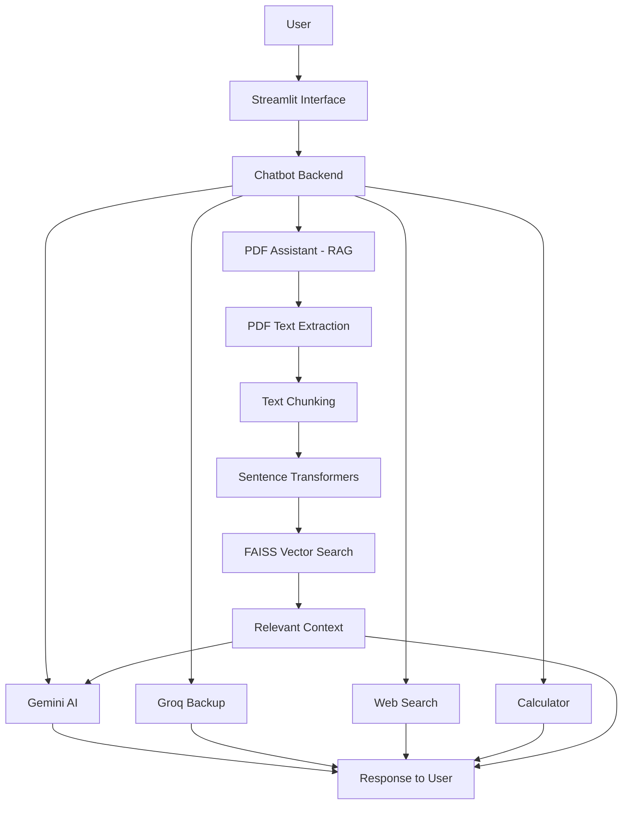

# 🤖 Buddy AI – Your Smart AI Companion

Buddy AI is an AI-powered chatbot built using Python and Streamlit. It helps users learn, solve problems, explore information, understand PDF documents, and get coding assistance through a simple, modern interface.

## 🚀 Live Demo

[Try Buddy AI](https://itsbuddyai.streamlit.app)

## ✨ Features

- **AI Chat:** Get answers to general questions using Gemini AI.
- **Backup AI Model:** Groq integration as a fallback.
- **Web Search:** Retrieve information about recent topics.
- **PDF Assistant (RAG):** Upload PDF documents and ask questions about their content.
- **AI Calculator:** Perform mathematical calculations safely.
- **Coding Assistant:** Generate and understand programming code.
- **Chat History:** Maintain and switch between conversations.
- **Modern Interface:** Clean and minimal Streamlit UI.

## 🛠️ Technologies Used

- Python
- Streamlit
- Google Gemini API
- Groq API
- DuckDuckGo Search
- PyPDF
- Sentence Transformers
- FAISS
- NumPy

## 🏗️ System Architecture



## 🧠 How It Works

1. User enters a question through the Streamlit interface.
2. Buddy AI identifies the required functionality.
3. The chatbot uses an AI model, web search, calculator, or PDF retrieval as appropriate.
4. The response is displayed in the chat interface.

## 📄 PDF Question Answering (RAG)

Buddy AI uses Retrieval-Augmented Generation (RAG) to answer questions from uploaded PDF documents.

The process includes:
1. Extracting text from the PDF.
2. Splitting text into smaller chunks.
3. Generating embeddings using Sentence Transformers.
4. Storing embeddings in a FAISS vector index.
5. Retrieving relevant text for a user's question.
6. Generating an answer using the retrieved context.

## ⚙️ Run Locally

### 1. Clone the repository

```bash
git clone https://github.com/Nidhi-Chauhan587/Buddy-AI.git
cd Buddy-AI
```

### 2. Create a virtual environment

```bash
python -m venv venv
```

### 3. Activate it (Windows)

```powershell
.\venv\Scripts\Activate.ps1
```

### 4. Install dependencies

```bash
pip install -r requirements.txt
```

### 5. Configure API keys

Create a `.env` file in the project folder:

```env
GEMINI_API_KEY=your_gemini_api_key
GROQ_API_KEY=your_groq_api_key
```

Never upload your `.env` file to GitHub.

### 6. Run the application

```bash
python -m streamlit run app.py
```

## 📁 Project Structure

```text
Buddy-AI/
│
├── app.py
├── chatbot.py
├── math_tool.py
├── search.py
├── pdf_reader.py
├── text_chunker.py
├── embedding_model.py
├── vector_store.py
├── rag.py
├── requirements.txt
├── .gitignore
└── README.md
```

## 👩‍💻 Developer

**Nidhi Chauhan**

B.Tech – Computer Science and Engineering (AI & ML)

## 🔗 Project Links

- Live Application: https://itsbuddyai.streamlit.app
- GitHub Repository: https://github.com/Nidhi-Chauhan587/Buddy-AI

---

*Built with Python, AI, and curiosity.*
